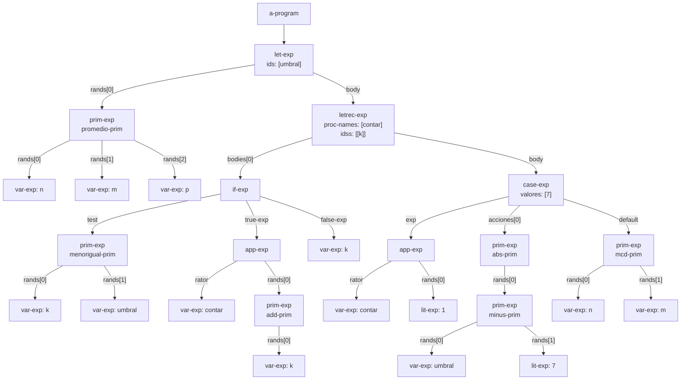
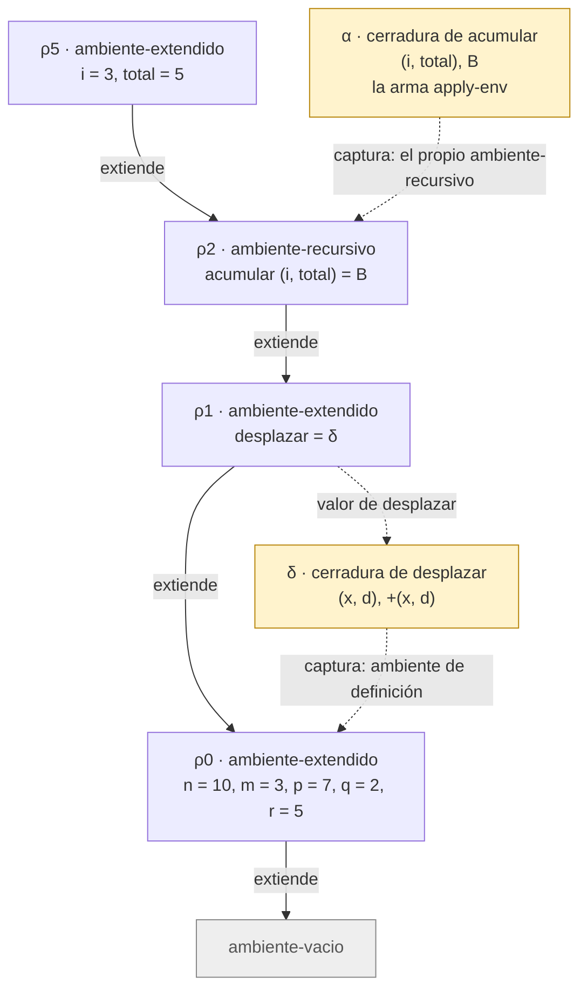

# Informe de AST — Taller 2: El intérprete de Cauca

**Curso:** Fundamentos de Interpretación y Compilación de Lenguajes
de Programación — Universidad del Valle, Sede Tuluá.

**Integrantes del grupo:**

| Nombre | Código | Correo institucional |
|--------|--------|----------------------|
| Juan S. Navarrete | 2459562 | COMPLETAR@correounivalle.edu.co |
| Samuel Garcia Parra | 202459476 | samuel.parra@correounivalle.edu.co |

---

## 1. Gramática considerada

Gramática BNF de Cauca. Debajo de cada producción va el constructor del
AST que genera SLLGEN.

```bnf
<programa>  ::= <expresion>
                a-program(exp)

<expresion> ::= <numero>
                lit-exp(dato)
            ::= <identificador>
                var-exp(id)
            ::= "true"
                true-exp()
            ::= "false"
                false-exp()
            ::= <primitiva> "(" {<expresion>}*(,) ")"
                prim-exp(prim, rands)
            ::= "if" <expresion> "then" <expresion> "else" <expresion> "end"
                if-exp(test, true-exp, false-exp)
            ::= "let" {<identificador> "=" <expresion>}* "in" <expresion> "end"
                let-exp(ids, rands, body)
            ::= "proc" "(" {<identificador>}*(,) ")" <expresion> "end"
                proc-exp(ids, body)
            ::= "apply" <expresion> "(" {<expresion>}*(,) ")"
                app-exp(rator, rands)
            ::= "letrec" {<identificador> "(" {<identificador>}*(,) ")" "=" <expresion>}*
                "in" <expresion> "end"
                letrec-exp(proc-names, idss, bodies, body)
            ::= "case" <expresion> {"of" <numero> "=>" <expresion>}*
                "otherwise" "=>" <expresion> "end"
                case-exp(exp, valores, acciones, default)

<primitiva> ::= "+" sum-prim() | "-" minus-prim() | "*" mult-prim() | "/" div-prim()
            ::= "add1" add-prim() | "sub1" sub-prim()
            ::= ">" mayor-prim() | ">=" mayorigual-prim()
            ::= "<" menor-prim() | "<=" menorigual-prim() | "==" igual-prim()
            ::= "not" not-prim() | "and" and-prim() | "or" or-prim()
            ::= "abs" abs-prim() | "mcd" mcd-prim() | "mcm" mcm-prim()
            ::= "promedio" promedio-prim() | "xor" xor-prim()
            ::= "implica" implica-prim() | "entre" entre-prim()
```

> **Nota sobre `case`.** SLLGEN solo ofrece `arbno` (cero o más), no
> `+`. Por eso la gramática implementada acepta un `case` con cero
> ramas `of`, aunque el enunciado pide al menos una. El constructor
> conserva los cuatro campos que exige el enunciado.

---

## 2. Ejemplos de AST

### Ejemplo 1 — `let` + `letrec` + `case` con aplicación y primitivas nuevas

**Expresión concreta:**

```scheme
let umbral = promedio(n, m, p)
in
  letrec
    contar (k) = if <=(k, umbral)
                 then apply contar (add1(k))
                 else k
                 end
  in
    case apply contar (1)
      of 7 => abs(-(umbral, 7))
      otherwise => mcd(n, m)
    end
  end
end
```

**AST** (obtenido con `(parser ...)` y dibujado con el nombre del
constructor en cada nodo; las etiquetas de las aristas son los nombres
de los campos):



**Explicación:**

- La raíz es `a-program`, con una sola expresión: el `let-exp` más
  externo, que liga `umbral` al `prim-exp` de `promedio` con tres
  `var-exp` (`n`, `m`, `p`).
- El cuerpo del `let-exp` es un `letrec-exp`. Declara un solo
  procedimiento, `contar`, de parámetro `k`. Su cuerpo (`bodies[0]`) es
  un `if-exp`: la condición es `<=(k, umbral)`, la rama verdadera es una
  aplicación (`app-exp`) cuyo operador es `contar` y cuyo argumento es
  `add1(k)`, y la rama falsa es `k`.
- El cuerpo del `letrec-exp` es un `case-exp`. Su expresión de control es
  la aplicación `apply contar (1)`. Tiene una rama (`valores: [7]`) cuya
  acción es `abs(-(umbral, 7))`, un `prim-exp` anidado dentro de otro, y
  la rama `otherwise` es `mcd(n, m)`. El literal `7` de la rama es un
  campo numérico de `case-exp` y no un nodo `lit-exp`; el `7` de
  `-(umbral, 7)` sí es un `lit-exp` porque es una expresión.
- **Comprobación con el intérprete.** Con el ambiente inicial,
  $\text{umbral} = \frac{10+3+7}{3} = \frac{20}{3}$. `contar` incrementa
  `k` mientras $k \le \frac{20}{3}$ y se detiene en $k = 7$. Como el
  control del `case` vale 7, se evalúa $\lvert \frac{20}{3} - 7 \rvert
  = \frac{1}{3}$, que es el resultado que devuelve `interpretar`.

---

## 3. Traza de evaluación

**Expresión a evaluar:**

```scheme
let desplazar = proc (x, d) +(x, d) end
in
  letrec
    acumular (i, total) = if >(i, m)
                          then total
                          else apply acumular
                                 (add1(i), apply desplazar (total, i))
                          end
  in
    apply acumular (1, q)
  end
end
```

**Ambiente inicial.** En la implementación es un solo
`ambiente-extendido` sobre el `ambiente-vacio`:

$$\rho_0 = [\,n = 10,\ m = 3,\ p = 7,\ q = 2,\ r = 5\,]$$

**Notación.** Se usa $\textit{value-of}(e, \rho) = v$. Sea $B$ el cuerpo
del `if` de `acumular`:

```scheme
if >(i, m) then total
else apply acumular (add1(i), apply desplazar (total, i)) end
```

Los ambientes y valores que aparecen en la traza son:

| Símbolo | Significado |
|---------|-------------|
| $\delta$ | cerradura de `desplazar`: $\langle (x, d),\ +(x, d),\ \rho_0 \rangle$ |
| $\rho_1$ | $[\,\textit{desplazar} = \delta\,]\ \rho_0$ |
| $\rho_2$ | `ambiente-recursivo` con `acumular` $(i, total) = B$, que extiende a $\rho_1$ |
| $\alpha$ | cerradura de `acumular`: $\langle (i, total),\ B,\ \rho_2 \rangle$, que construye `apply-env` al buscar `acumular` |
| $\rho_3$ | $[\,i = 1,\ total = 2\,]\ \rho_2$ |
| $\rho_4$ | $[\,i = 2,\ total = 3\,]\ \rho_2$ |
| $\rho_5$ | $[\,i = 3,\ total = 5\,]\ \rho_2$ |
| $\rho_6$ | $[\,i = 4,\ total = 8\,]\ \rho_2$ |
| $\sigma_1,\sigma_2,\sigma_3$ | ambientes de las llamadas a `desplazar`: $[\,x=2, d=1\,]\rho_0$, $[\,x=3, d=2\,]\rho_0$, $[\,x=5, d=3\,]\rho_0$ |

Todos los $\rho_3 \ldots \rho_6$ extienden a $\rho_2$ (el ambiente de la
cerradura $\alpha$), y todos los $\sigma_k$ extienden a $\rho_0$ (el
ambiente de la cerradura $\delta$), **no** al ambiente de la llamada.

### 3.1 Ligaduras iniciales

| # | Expresión | Ambiente | Resultado |
|---|-----------|----------|-----------|
| 1 | `let desplazar = … in letrec … end end` | $\rho_0$ | $8$ (paso 20) |
| 2 | rand del `let`: `proc (x, d) +(x, d) end` | $\rho_0$ | $\delta$ (no evalúa el cuerpo) |
| 3 | cuerpo del `let`: `letrec acumular … in … end` | $\rho_1$ | $8$ |
| 4 | cuerpo del `letrec`: `apply acumular (1, q)` | $\rho_2$ | $8$ |
| 5 | operador `acumular` | $\rho_2$ | $\alpha$ (`apply-env` encuentra el nombre en $\rho_2$ y arma la cerradura con $\rho_2$) |
| 6 | operandos `1` y `q` | $\rho_2$ | $1$ y $2$ (`q` se encuentra bajando hasta $\rho_0$) |
| 7 | `apply-procedure`$(\alpha, (1\ 2))$ evalúa $B$ | $\rho_3$ | ver llamada 1 |

### 3.2 Llamada 1: `acumular(1, 2)`

| # | Expresión | Ambiente | Resultado |
|---|-----------|----------|-----------|
| 8 | `>(i, m)` | $\rho_3$ | `>(1, 3)` = `#f` |
| 9 | `acumular` (operador de la rama else) | $\rho_3$ | $\alpha$ |
| 10 | `add1(i)` | $\rho_3$ | $2$ |
| 11 | `apply desplazar (total, i)` | $\rho_3$ | operador $\delta$; operandos $2$ y $1$; cuerpo `+(x, d)` en $\sigma_1$ $\Rightarrow 3$ |
| 12 | `apply-procedure`$(\alpha, (2\ 3))$ evalúa $B$ | $\rho_4$ | ver llamada 2 |

### 3.3 Llamada 2: `acumular(2, 3)` (primera llamada recursiva)

| # | Expresión | Ambiente | Resultado |
|---|-----------|----------|-----------|
| 13 | `>(i, m)` | $\rho_4$ | `>(2, 3)` = `#f` |
| 14 | `add1(i)` y `apply desplazar (total, i)` | $\rho_4$ | $3$ y, con $\sigma_2$, `+(3, 2)` $= 5$ |
| 15 | `apply-procedure`$(\alpha, (3\ 5))$ evalúa $B$ | $\rho_5$ | ver llamada 3 |

### 3.4 Llamada 3: `acumular(3, 5)` (segunda llamada recursiva)

| # | Expresión | Ambiente | Resultado |
|---|-----------|----------|-----------|
| 16 | `>(i, m)` | $\rho_5$ | `>(3, 3)` = `#f` |
| 17 | `add1(i)` y `apply desplazar (total, i)` | $\rho_5$ | $4$ y, con $\sigma_3$, `+(5, 3)` $= 8$ |
| 18 | `apply-procedure`$(\alpha, (4\ 8))$ evalúa $B$ | $\rho_6$ | ver llamada 4 |

### 3.5 Llamada 4: `acumular(4, 8)` (tercera llamada recursiva)

| # | Expresión | Ambiente | Resultado |
|---|-----------|----------|-----------|
| 19 | `>(i, m)` | $\rho_6$ | `>(4, 3)` = `#t` |
| 20 | rama `then`: `total` | $\rho_6$ | $8$ |

El valor $8$ sube sin más trabajo por los pasos 18, 15, 12, 7, 4 y 3,
y es el resultado del programa completo (paso 1):

$$\textit{value-of}(e, \rho_0) = 8$$

donde $e$ es el programa completo (el `let` de `desplazar`).

Se cuenta como **primera llamada recursiva** la que ocurre desde el
cuerpo de `acumular`, es decir, `acumular(2, 3)`; la llamada inicial
`acumular(1, 2)` viene del cuerpo del `letrec` y no es recursiva. Por
eso la **segunda llamada recursiva** es `acumular(3, 5)` y el diagrama
siguiente muestra el ambiente $\rho_5$.

### 3.6 Cadena de ambientes en la segunda llamada recursiva

Estado al evaluar $B$ en $\rho_5$ (llamada `acumular(3, 5)`). Las
flechas continuas van del ambiente que extiende al ambiente extendido;
las punteadas indican qué ambiente captura cada cerradura.



**Lectura del diagrama.**

- Buscar `i` o `total` termina en $\rho_5$. Buscar `acumular` baja a
  $\rho_2$, que no guarda una cerradura sino los nombres, parámetros y
  cuerpos: `apply-env` arma $\alpha$ en ese momento y le entrega
  $\rho_2$. Por eso el cuerpo $B$ siempre puede volver a encontrar
  `acumular`, y la recursión funciona.
- Buscar `desplazar` baja de $\rho_5$ a $\rho_2$ y de ahí a $\rho_1$,
  donde está ligada a $\delta$. Buscar `m` baja hasta $\rho_0$.
- $\delta$ captura $\rho_0$ y no el ambiente donde se llama, así que el
  cuerpo `+(x, d)` se evalúa en $\sigma_k$, que extiende a $\rho_0$.
- La cadena termina en `ambiente-vacio`; un identificador que no esté
  en ninguno de los cuatro ambientes produce el error de variable no
  ligada.

---

## 4. Estado del almacén en una transacción

**No aplica.** Cauca no tiene almacén ni bloques transaccionales, y el
enunciado de este taller no pide esta sección.

---

## 5. Referencias

- Friedman, D. P., & Wand, M. *Essentials of Programming Languages*,
  3.ª ed., MIT Press, 2008. Sección 2.5 (tipos de datos y ASTs),
  sección 3.2 (el lenguaje LET y los ambientes), sección 3.3
  (procedimientos y clausuras, Figura 3.7) y sección 3.4
  (procedimientos recursivos, Figura 3.9).
- The Racket Guide, *Parsing with SLLGEN*, documentación del lenguaje
  `eopl`.
- Mermaid, *Flowcharts*: https://mermaid.js.org/syntax/flowchart.html
