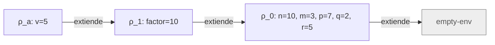
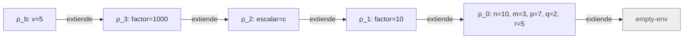

# Informe de corrección — Taller 2: El intérprete de Cauca

**Curso:** Fundamentos de Interpretación y Compilación de Lenguajes
de Programación — Universidad del Valle, Sede Tuluá.

**Integrantes del grupo:**

| Nombre | Código | Correo institucional |
|--------|--------|----------------------|
| Juan Sebastian Navarrete Rada | 2459562 | {{juan.sebastian.navarrete@correounivalle.edu.co}} |
| Samuel Garcia Parra | {{Código 2}} | {samuel.parra@correounivalle.edu.co} |

---

## 1. Marco formal

### 1.1 Corrección de programas recursivos

Sea $f : A \to B$ una función y $A$ un conjunto definido
recursivamente. Sea $P_f$ un programa recursivo en Racket que
pretende calcular $f$. Decimos que $P_f$ es correcto con respecto a
su especificación si se cumple:

$$
\forall a \in A \,:\, P_f(a) = f(a)
$$

La estrategia de demostración es la **inducción estructural**
sobre $A$:

- **Caso base:** para cada valor básico $a_0 \in A$ se verifica
  $P_f(a_0) = f(a_0)$.
- **Caso inductivo:** asumiendo la **hipótesis de inducción**
  $P_f(a') = f(a')$ para las subestructuras $a'$ que forman $a$, se
  demuestra $P_f(a) = f(a)$.

### 1.2 Corrección de programas iterativos

Para un programa iterativo se formalizan:

- Un estado $s$ con componentes relevantes.
- Un estado inicial $s_0$.
- Un estado final reconocido por un predicado $\text{es-final?}(s)$.
- Una **invariante** $\text{Inv}(s)$ que se mantiene entre pasos.
- Una transformación $\text{transformar}(s)$.

La corrección se argumenta demostrando:

1. $\text{Inv}(s_0)$ se cumple al inicio.
2. $\text{Inv}(s) \,\land\, \lnot\text{es-final?}(s)\Rightarrow
   \text{Inv}(\text{transformar}(s))$.
3. $\text{Inv}(s) \,\land\, \text{es-final?}(s)\Rightarrow
   \text{respuesta}(s) = f(\text{entrada})$.
4. El proceso termina (argumentar una función de cota estrictamente
   decreciente sobre $\mathbb{N}$).

---

## 2. Funciones analizadas

### 2.1 Corrección de `apply-procedure`

**Notación.** Una clausura es la tripleta
$\langle (x_1,\ldots,x_n),\, b,\, \rho_c \rangle$: parámetros, cuerpo sin
evaluar y ambiente de definición. Escribimos
$[x_1=v_1,\ldots,x_n=v_n]\cdot\rho$ para el ambiente que extiende a $\rho$
con esas ligaduras (en el código, `ambiente-extendido`).

**Especificación.**

- **Tipo:** `apply-procedure : procval x lista-de-valores -> valor`
- **Pre-condición:**
  $\text{Pre}(p,\vec v)\equiv p=\langle (x_1,\ldots,x_n),\,b,\,\rho_c\rangle
  \;\land\; \rho_c \text{ es un ambiente} \;\land\; \vec v=(v_1,\ldots,v_k)$
  es una lista de valores ya evaluados.
- **Post-condición:**
  $$
  \text{Post}(p,\vec v,r)\equiv
  \bigl(n=k \Rightarrow r=\text{value-of}\bigl(b,\,[x_1=v_1,\ldots,x_n=v_n]\cdot\rho_c\bigr)\bigr)
  \;\land\;
  \bigl(n\neq k \Rightarrow \text{se levanta error}\bigr)
  $$

**Código.**

```racket
; apply-procedure : procval x lista de valores -> valor
; Propósito: verifica la cantidad de argumentos y evalúa el cuerpo en el
; ambiente de la clausura extendido con los parámetros.
(define apply-procedure
  (lambda (proc args)
    (cases procval proc
      (cerradura (ids body env)
        (if (= (length ids) (length args))
            (evaluar-expresion body (ambiente-extendido ids args env))
            (eopl:error 'apply-procedure
                        "Se esperaban ~s argumentos, llegaron ~s"
                        (length ids) (length args)))))))
```

y el caso de `app-exp` en `evaluar-expresion`, que usa a `apply-procedure`:

```racket
(app-exp (rator rands)
  (let ((proc (evaluar-expresion rator env)))
    (if (procval? proc)
        (let ((args (evaluar-rands rands env)))
          (apply-procedure proc args))
        (eopl:error 'app-exp "El operador no es un procedimiento: ~s" proc))))
```

**Estrategia de demostración.** `apply-procedure` no es recursiva por sí
misma: la demostración es un análisis de casos sobre la cantidad de
argumentos. Para el caso en que se evalúa el cuerpo se usa como hipótesis
que `evaluar-expresion` es correcta sobre el cuerpo $b$ (hipótesis de
inducción sobre la derivación de la evaluación). Se asume que los
parámetros son distintos entre sí.

**Lema (búsqueda con shadowing, ver sección 3).** Si
$\rho'=[x_1=v_1,\ldots,x_n=v_n]\cdot\rho$, entonces
$\text{apply-env}(\rho',x_i)=v_i$ y, si $x\notin\{x_1,\ldots,x_n\}$,
$\text{apply-env}(\rho',x)=\text{apply-env}(\rho,x)$.

#### (a) El cuerpo se evalúa en el ambiente de la clausura, no en el de la llamada

**Argumento estructural.** `apply-procedure` recibe solo dos datos:
`proc` y `args`. El ambiente de la llamada no es un parámetro suyo, así que
no puede usarlo. El único ambiente disponible es el campo `env` de la
clausura, que `proc-exp` fijó al construirla:

$$
\text{value-of}(\texttt{proc}(\vec x)\ b\ \texttt{end},\,\rho)
=\langle \vec x,\, b,\, \rho\rangle
$$

Por el código, con $p=\langle \vec x,b,\rho_c\rangle$ y $n=k$:

$$
\text{apply-procedure}(p,\vec v)
= \text{value-of}\bigl(b,\ \text{ambiente-extendido}(\vec x,\vec v,\rho_c)\bigr)
= \text{value-of}\bigl(b,\,[\vec x=\vec v]\cdot\rho_c\bigr)
$$

que es exactamente la post-condición.

**Contraste con el ejemplo de la Parte 3.**

```text
let factor = 10
in let escalar = proc (v) *(v, factor) end
   in let factor = 1000
      in apply escalar (5) end
   end
end
```

Sea $\rho_0=[n=10,m=3,p=7,q=2,r=5]$. La evaluación construye:

- $\rho_1=[\text{factor}=10]\cdot\rho_0$.
- $c=\langle (v),\ *(v,\text{factor}),\ \rho_1\rangle$, porque `proc-exp` se evalúa en $\rho_1$.
- $\rho_2=[\text{escalar}=c]\cdot\rho_1$.
- $\rho_3=[\text{factor}=1000]\cdot\rho_2$, el ambiente de la llamada.

La llamada `apply escalar (5)` se evalúa en $\rho_3$ y busca `escalar`,
que encuentra en $\rho_2$ y da $c$. Hay dos opciones para evaluar el cuerpo:

**Implementación correcta: ambiente de la clausura (resultado 50).** Se
evalúa en $\rho_a=[v=5]\cdot\rho_1$, y por el lema $\text{factor}=10$:

$$
\text{value-of}(*(v,\text{factor}),\rho_a)=5\cdot 10=50
$$



**Implementación errónea: ambiente de la llamada (resultado 5000).** Se
evaluaría en $\rho_b=[v=5]\cdot\rho_3$, y por el lema
$\text{factor}=1000$:

$$
\text{value-of}(*(v,\text{factor}),\rho_b)=5\cdot 1000=5000
$$



La diferencia entre las dos cadenas es la ligadura de `factor` que se
encuentra primero: $\rho_1$ (definición) o $\rho_3$ (llamada). Esa es la
razón por la que un procedimiento debe recordar el ambiente donde nació.

#### (b) Error exactamente cuando el operador no es procedimiento o la cantidad no coincide

Sea `app-exp(rator, rands)` evaluada en $\rho$. Suponemos que la evaluación
del operador y de los argumentos termina sin error; los errores de esas
subexpresiones se propagan y no son errores propios de la aplicación. Sea
$p=\text{value-of}(\text{rator},\rho)$. Los únicos `eopl:error` de
`app-exp` y `apply-procedure` son dos, y los tres casos siguientes son
exhaustivos y excluyentes:

1. **$p$ no es un procedimiento** (`procval?` falso): `app-exp` toma la rama
   `else` y levanta error, antes de evaluar los argumentos.
2. **$p=\langle(x_1..x_n),b,\rho_c\rangle$ y $n\neq k$:** `app-exp` llama
   a `apply-procedure`, cuyo `if` falla en `(= (length ids) (length args))`
   y levanta error.
3. **$p$ es un procedimiento y $n=k$:** ninguna de las dos ramas de error
   es alcanzable; el resultado es el de la post-condición.

Como los dos `eopl:error` solo son alcanzables en los casos 1 y 2, y esos
casos levantan error, la aplicación levanta error **si y solo si** el
operador no es un procedimiento o la cantidad de argumentos no coincide.

**Terminación.** `apply-procedure` hace una cantidad finita de pasos propios
(`length` sobre listas finitas y un `if`) y luego delega en
`evaluar-expresion`. Por eso se demuestra **corrección parcial**: si la
evaluación del cuerpo termina, el resultado es el especificado. La
terminación total no se garantiza en general: la autoaplicación
`let f = proc (x) apply x (x) end in apply f (f) end` no termina.

**Conclusión:** `apply-procedure` cumple $\text{Post}$ siempre que se
cumpla $\text{Pre}$; por lo tanto es correcta respecto a su especificación.

---

### 2.2 Corrección de la ligadura recursiva (`letrec` y `ambiente-recursivo`)

**Especificación.**

- **Tipo:** `{{apply-env sobre ambiente-recursivo : ambiente x symbol -> valor}}`
- **Invariante:** {{propiedad que debe cumplir el ambiente en el que se evalúa el cuerpo de un procedimiento declarado con letrec}}.
- **Pre-condición:** {{...}}.
- **Post-condición:** {{...}}.

**Código.**

```racket
{{código de ambiente-recursivo y del caso letrec-exp}}
```

**Demostración.**

1. Invariante: {{enunciado}}.
2. `apply-env` sobre un `ambiente-recursivo` construye una clausura que
   satisface el invariante: {{demostración}}.
3. Por qué la misma declaración con `let` no lo satisface y qué error
   produce: {{explicación}}.
4. Terminación del ejemplo de `potencia`, con la medida que decrece en
   cada llamada: {{argumento}}.

**Conclusión:** {{...}}

---

### 2.3 Corrección de `case-exp`

**Especificación.**

- **Tipo:** `{{...}}`
- **Pre-condición:** {{...}}.
- **Post-condición:** {{...}}.

**Código.**

```racket
{{código del caso case-exp}}
```

**Demostración.**

1. Inducción estructural sobre la lista de ramas: se evalúa la acción de la
   primera coincidencia, se evalúa `otherwise` si no hay ninguna y se
   levanta error si el valor de control no es un número: {{demostración}}.
2. La expresión de control se evalúa una sola vez, sin importar cuántas
   ramas tenga: {{demostración}}.
3. Terminación del recorrido sobre las ramas: {{medida}}.

**Conclusión:** {{...}}

---

## 3. Propiedades adicionales

Las propiedades sobre almacén, transacciones, paso por referencia y
chequeo de tipos no aplican a este taller.

**Shadowing de `apply-env`.** Sea
$\rho'=[x_1=v_1,\ldots,x_n=v_n]\cdot\rho$ con $n$ valores. Entonces
$\text{apply-env}(\rho',x_i)=v_i$ (la ligadura más reciente tiene
prioridad) y, si $x\notin\{x_1,\ldots,x_n\}$,
$\text{apply-env}(\rho',x)=\text{apply-env}(\rho,x)$. Sobre
`ambiente-vacio` se levanta error.

*Demostración.* Por análisis de casos sobre el código de `apply-env`: en
`ambiente-extendido`, `posicion` devuelve el índice de la primera
coincidencia de $x$ en `ids`; si existe, se retorna `(list-ref vals pos)`,
que es $v_i$; si es `#f`, la búsqueda continúa en el ambiente previo $\rho$.
En `ambiente-vacio` no hay ligaduras y se llama a `eopl:error`. $\blacksquare$

---

## 4. Referencias

- Friedman, D. P., & Wand, M. *Essentials of Programming Languages*,
  3.ª ed., MIT Press, 2008. Secciones 3.2 (el lenguaje LET), 3.3
  (procedimientos y clausuras, Figura 3.7) y 3.4 (procedimientos
  recursivos, Figura 3.9).
